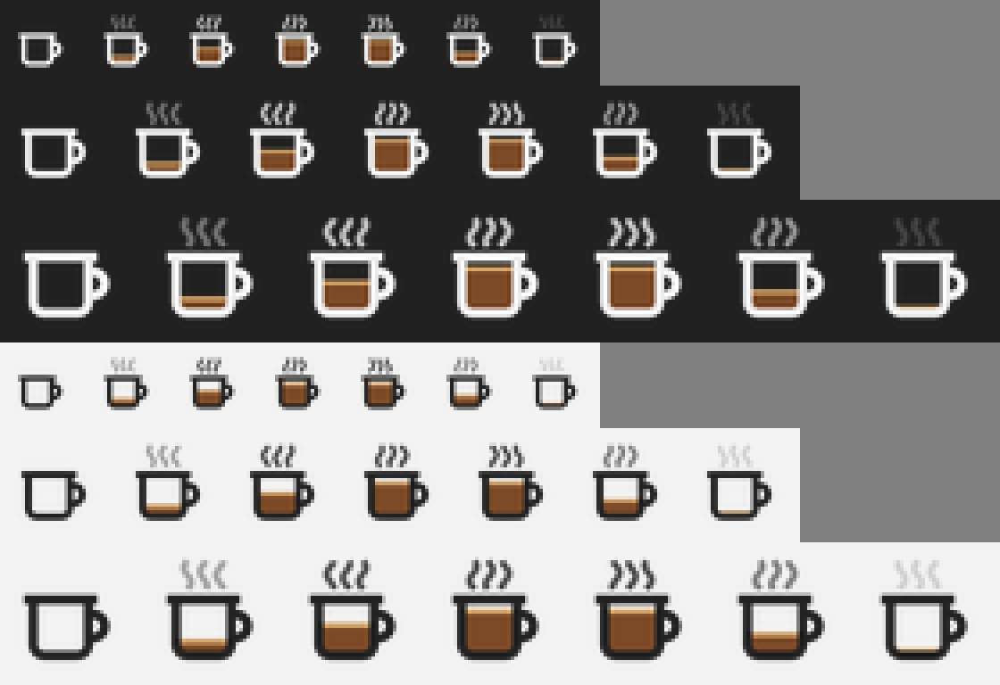

# ☕ CoffeeCup

A tiny Windows tray app that keeps your PC awake, in the spirit of Caffeine.
**Double-click the mug** to stay awake, then double-click again to let the PC sleep.



- **Empty mug:** Windows may sleep as usual.
- **Coffee pours in** (with steam) when you activate it.
- **Timed sessions drain the mug** as the time runs out. When it's empty, CoffeeCup lets the PC sleep again.

## Install

1. Open **Releases** and download `CoffeeCup-Setup-x.y.z.exe`.
2. Run it. It installs just for you, so no admin prompt. You can pick "Start CoffeeCup when I sign in".
3. Look for the mug in the notification area. On Windows 11 it may be hidden under the **^** arrow at first. To keep it visible, drag it onto the taskbar, or turn it on under *Settings → Personalization → Taskbar → Other system tray icons*.

It needs Windows 10 or 11. The app is a single ~50 KB .NET Framework 4.8 executable, which Windows already includes.

Uninstall it from *Settings → Apps*. That also removes the startup entry and settings.

## Using it

| Action | What happens |
|---|---|
| Double-click the mug | Toggles staying awake, for your chosen duration |
| Hover | Shows the status and the time left |
| Right-click → **Stay awake for** | Starts a session of 15 min to 8 h, or indefinitely. The ✓ choice becomes the double-click default |
| Right-click → **Keep screen on** | On: the display stays on too. Off: only the system stays awake, so the screen can still turn off |
| Right-click → **Stay awake with lid closed** | On (the default): closing the lid does nothing while the mug is on. Careful: a running laptop in a bag gets hot |
| Right-click → **Start with Windows** | Launches CoffeeCup when you sign in |
| Right-click → **Stay awake when CoffeeCup starts** | Activates straight away at launch |

Settings live in `HKCU\Software\CoffeeCup`.

**How it works:** while it's on, CoffeeCup does up to four things:

1. It holds a Windows power request
   ([`SetThreadExecutionState`](https://learn.microsoft.com/windows/win32/api/winbase/nf-winbase-setthreadexecutionstate),
   the same call PowerToys Awake uses).
2. Like the original Caffeine, once you've been idle for 30 seconds it taps **F15**, a key almost no app
   reacts to, so Windows sees activity. This is what keeps managed PCs and Modern Standby laptops awake,
   because those can ignore power requests. This only happens with *Keep screen on* ticked (the default),
   since a key press also keeps the screen on.
3. It sets your power plan's **Sleep after** and **Hibernate after** timeouts to *Never*, without touching the
   screen timeout. When the mug goes off, or you exit or sign out, it puts your values back. If you change
   them yourself in the meantime, it leaves your change alone. This is what lets a Modern Standby laptop stay awake
   with its screen off. Windows can idle one of these into standby even while a power request is active.
4. With *Stay awake with lid closed* ticked, it sets **When I close the lid** to *Do nothing* (plugged in and on
   battery), and restores your setting the same way.

   The original values are saved under `HKCU\Software\CoffeeCup\SavedSleepSettings` until restored, so a
   crash can't leave your PC set to never sleep: they're put back the next time CoffeeCup starts.

Pressing the power button or choosing Sleep yourself still puts the PC to sleep. So does closing the lid, unless
*Stay awake with lid closed* is ticked.

### If your PC still sleeps

With CoffeeCup on, open a Command Prompt and run `powercfg /requests`. `CoffeeCup.exe` should appear under
**SYSTEM** (and under **DISPLAY** when *Keep screen on* is ticked). If it's listed but the PC still sleeps, a
power policy is overriding it. If your organization manages the sleep settings, CoffeeCup warns you, and only
*Keep screen on* will keep the PC awake. Please open an issue with the output of `powercfg /requests` and `powercfg /a`.

## Building

GitHub Actions (`.github/workflows/build.yml`) builds the app and the Inno Setup installer on every push. Every push to
`main` also publishes a GitHub Release named after `<Version>` in `src/CoffeeCup/CoffeeCup.csproj`, for example `v1.0.3`,
with the installer attached. Bump the version to publish a new release.

To build locally on Windows:

```powershell
dotnet build src/CoffeeCup/CoffeeCup.csproj -c Release
& "${env:ProgramFiles(x86)}\Inno Setup 6\ISCC.exe" /DAppVersion=1.0.0 installer\CoffeeCup.iss   # → dist\
```

The tray icon is drawn at runtime by `src/CoffeeCup/MugRenderer.cs`, so it stays crisp at any DPI and follows the light or dark taskbar.
`tools/make_icon.py` (Pillow) draws the same design and regenerates `assets/CoffeeCup.ico` (the .exe and installer icon) and the preview above.
